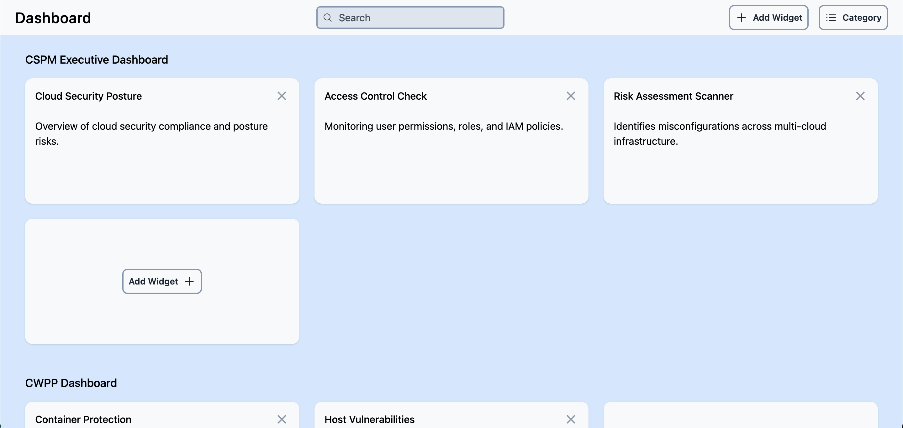
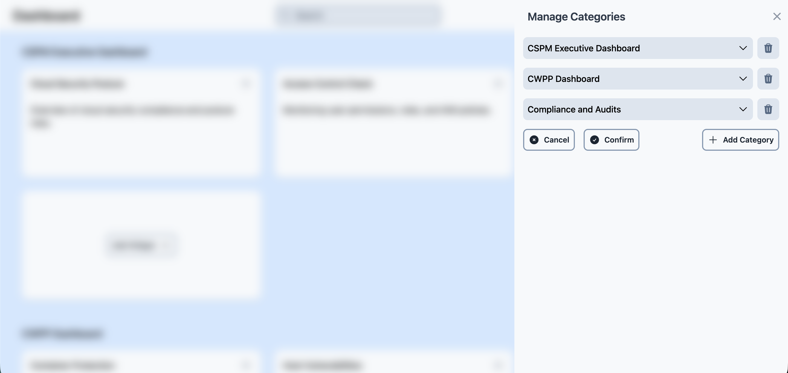
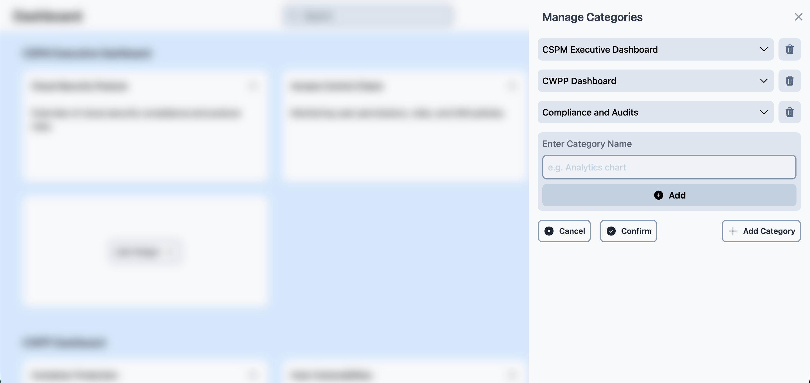
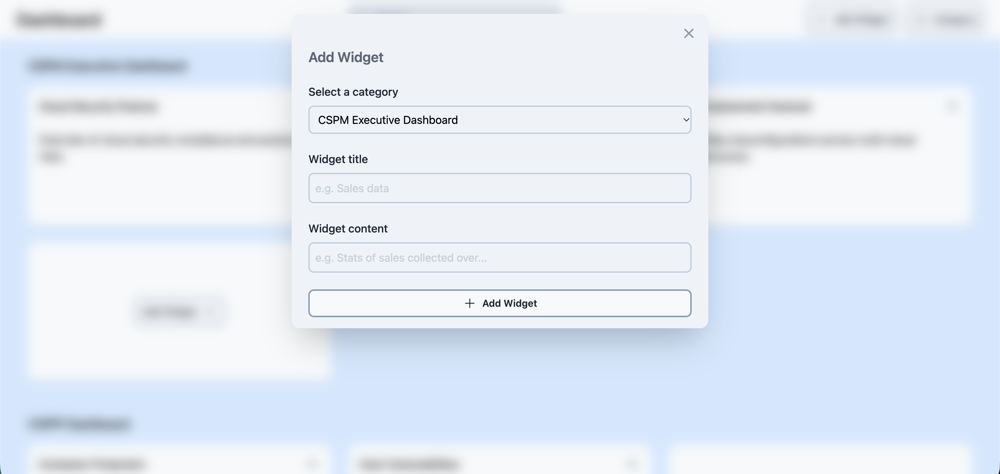
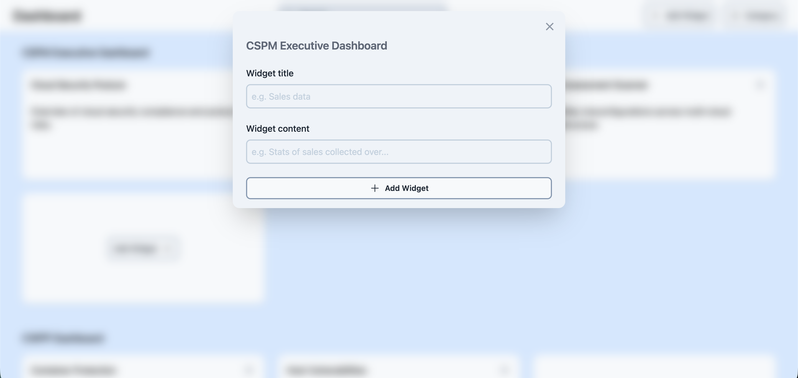
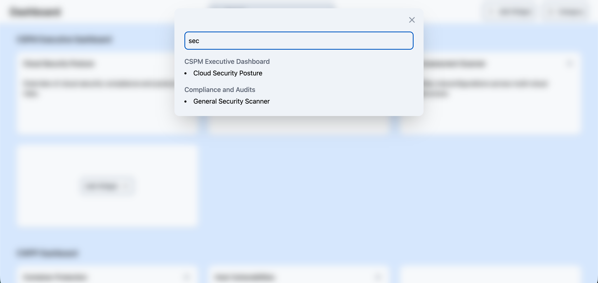

# DASHBOARD

A dashboard page that lets users manage categories and widgets.



## Features

### 1. Manage categories

> Manage widgets for each category



> Add category



### 2. Add widgets

> Select any category and add widget



> Add widget for particular category



### 3. Search

> Search category or widgets



## Installation

### 1. Clone repository

```
git clone https://github.com/arijit-malakar/assignment-dashboard.git
```

### 2. Install dependencies

```
cd assignment-dashboard
npm install
```

### 3. Start dev server

```
npm run dev
```
